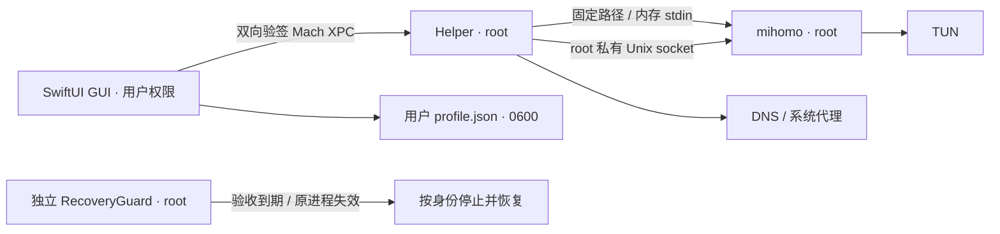

# ClairRoute 架构与安全设计

本文面向想了解实现细节或参与开发的读者。日常使用请看 [README](../README.md)；英文的组件契约见 [ImplementationContract.md](ImplementationContract.md)。

## 组成部分

| 组件 | 权限 | 职责 |
| --- | --- | --- |
| `App/`（ClairRoute.app） | 当前用户 | SwiftUI 界面、节点 / 订阅 / 规则资料库、订阅下载与解析 |
| `Helper/`（ClairRouteHelper） | root LaunchDaemon | 经双向验签的 XPC 接收有限请求；生成配置、启动 / 热重载 / 停止 mihomo；修改并恢复 DNS 与系统代理；监督界面心跳、睡眠和网络变化 |
| ClairRouteRecoveryGuard | root LaunchDaemon（独立进程） | 只负责 120 秒限时验收的到期回滚；没有任何管理接口 |
| `Shared/` | — | 三者共用的数据模型、受限 YAML 解析器、订阅解析器和配置生成器 |
| mihomo v1.19.31 | root（由 Helper 启动） | 实际代理内核；只从固定的、已校验的 root 私有路径启动 |

Helper 与 RecoveryGuard 由同一组 `Helper/*.swift` 源码编译，用 `CLAIRROUTE_RECOVERY_GUARD` 编译条件区分入口。

## 签名方案

**没有付费账号：** 当前采用自签名代码签名证书、精确证书固定和需管理员授权的手动 LaunchDaemon。私钥留在 login Keychain，证书仅加入 codeSign 用途信任，不改变 TLS 信任。双方 XPC requirement 使用精确 bundle identifier + `certificate leaf` SHA1；二进制完整性另用 SHA256。此方式用于本机，不具备 Developer ID 公证与分发能力。

**有付费账号：** 可另做 Developer ID Application 签名、公证、staple 与 `SMAppService.daemon` 发布构建；双方 requirement 应使用 Apple anchor、固定 Team ID 和 identifier，适应证书续期。macOS 对后台 daemon 的注册 / 批准有签名和公证策略要求，不能将自签名或 ad-hoc 的 SMAppService 注册视为稳定发布方案。工程包含标准内嵌 daemon plist；当前实际可用的部署路径是手动本机安装。未使用 SMJobBless，也不关闭 SIP 或 Gatekeeper。

## 权限和秘密



- Helper 无 TCP 管理端口。mihomo controller 位于 root:wheel、0700 的 `run/`，不向 GUI 直接开放。固定 mihomo 的 Unix controller 不验证 HTTP secret 且自行设置 socket 权限，因此目录隔离和有限 XPC 是必要边界。
- XPC 仅接受有界类型：应用配置、停止 / 恢复、状态、心跳、固定连接快照、节点选择及固定目标测速。没有命令执行、任意路径、任意 YAML 或 HTTP 转发接口。检查当前 console UID、代码签名和会话所有权。
- 密码、服务器 UUID、订阅 URL、订阅原始数据、节点信息和规则统一保存到 `~/Library/Application Support/ClairRoute/profile.json`。这是用户明确选择的明文存储；文件权限为 `0600`，所属目录为 `0700`，有当前用户文件访问权限的程序仍可读取内容。不要把此文件加入源码、日志或公开附件。
- 当前文件格式为 v3：`nodes` / `subscriptions` 保存资料，`nodeSecrets` / `subscriptionSecrets` 保存凭据，内部引用用于关联记录。单文件上限为 32 MiB；导入、编辑、删除和订阅刷新都通过原子替换更新同一配置文件。失败时保留上一个完整版本，不会先覆盖一部分凭据再更新节点列表。日常启动、切换模式、读取节点和订阅刷新不访问钥匙串。
- 旧版钥匙串配置需在应用内明确执行一次迁移：先读取所有旧凭据，再原子保存 v3 明文文件，保存成功后才删除旧条目。读取阶段可能仍需要 macOS 授权；迁移失败时原资料保留。若旧条目删除失败，文件保留待清理引用，只在用户明确重试时访问钥匙串；日常使用不会自动重试。
- 本机代码签名私钥仍留在 login Keychain，用于构建和验签；它与订阅和节点凭据无关。重新安装仍需管理员授权，但不因正常读取新版配置而触发节点钥匙串提示。
- 配置在内存中从基础模板、用户规则、订阅规则生成。订阅由普通权限 GUI 以 ephemeral HTTPS 获取和本地解析，生成 inline proxy-providers；不让 root 内核读取订阅 URL 或创建含密码的 provider 缓存。
- mihomo `-t -f -` 经 stdin 校验，启动同样使用 stdin；热重载使用私有 socket 的 payload。上一版配置仅在内存保留，失败时回滚。没有写含密码的 config.yaml，没有把配置放进 argv 或日志。
- URI、YAML 和规则均按不可信输入处理。YAML 支持 JSON、普通缩进映射 / 序列、引号与 flow collection；不执行标签，不展开 anchor / alias，不合并任意外部 provider。超限、未知影响连接语义的字段或危险字段会明确拒绝，不在线转换。
- SS 插件仅允许内核支持的内置选项，不运行外部插件。SS2022 支持规范 Base64 单密钥，长度按 cipher 校验。

## 网络恢复与验收

默认 TUN 为 mixed、auto-route、auto-detect-interface、TCP / UDP 53 hijack、fake-ip，进程识别 strict。使用固定 `utun197`；已存在或检测到竞争 VPN / 默认隧道路由时拒绝启动。系统代理入口仅监听 `127.0.0.1:17890`，DNS 在 TUN 开启时监听 loopback 53，没有 LAN 管理接口。

Helper 串行管理配置应用，先预检，再等内核状态健康，再修改系统设置。关闭监听前恢复指向它的 DNS / 代理。按 network service UUID 记录原值，恢复时只撤销仍由本应用拥有的值，不盲目覆盖另一 VPN 或用户后来修改的设置。

生产内核以 suspended 状态创建，先持久记录固定路径、PID、出生时间和接口身份，再恢复执行。Helper 重启按身份回收旧内核并恢复网络。GUI 退出等待恢复；进程退出 / XPC 断开 / 心跳租约过期触发恢复。休眠暂停 GUI 租约判断，唤醒有宽限；网络事件合并后重新检测和应用，失败保守关闭。

**首次联网验收使用“开始 120 秒 TUN 验收”：**

如果当前连接依赖其他客户端的 TUN，可先选择“开始 120 秒系统代理验收”：保持现有客户端运行，只把系统代理临时指向 ClairRoute；不创建新 TUN、不修改 DNS，到期恢复原代理。这只验证内核与系统代理恢复，不代表独立 TUN 分流已验证。任何新代理都可能暂时影响遵循系统代理的连接；限时回滚仍然启用。不要直接关闭维持当前会话的其他 TUN。

1. 先完成离线测试、安装及恢复服务状态检查，保留现有其他代理客户端的安装和配置。
2. 一次只改变一个接管方式。不要同时开启其他客户端的增强模式。
3. Helper 必须看到独立 RecoveryGuard 的真实 root 进程与新鲜心跳，才允许限时会话开始。
4. Guard 用连续时钟计算固定 120 秒期限，睡眠时间也计入；重配不能延长期限或偷偷转成普通会话。
5. 到期先写持久恢复标记阻止新会话，按固定路径、root UID、PID 和出生时间确认 Helper，再终止它并取得跨进程锁，恢复内核 / DNS / 系统代理。与 Helper 不并发写恢复状态，PID 复用不会导致误杀。
6. 回滚不需要 GUI、网络或远程助手在线；恢复未成功会保留记录并继续阻止启动。物理网络故障或系统网络 API 失效仍可能需要本机处理，不能承诺任何故障下绝不离线。

**本机恢复入口：** 应用“恢复网络并关闭代理”；GUI 失效时由 Helper watchdog 处理；限时验收中由独立 Guard 到期恢复。不要使用全局 route flush、删除 utun 或删除恢复 journal 代替恢复。需要手动重启守护进程时，固定命令如下（会停止 ClairRoute 当前会话）：

```bash
sudo launchctl kickstart -k system/local.nano.ClairRoute.RecoveryGuard
sudo launchctl kickstart -k system/local.nano.ClairRoute.Helper
```

普通会话不会因 Guard 空闲心跳而改动网络；“直连”模式也不等于关闭 TUN。

## 离线测试与实际验收

`Tests/` 的解析、golden 配置、排序、资料事务、响应头和恢复判定测试使用虚构凭据、临时目录及模拟旧版 vault，不访问真实 Keychain、订阅网络或系统网络设置。测试命令见 `Tests/README.md`。

真机验收应分别覆盖：界面操作、签名与安装、TUN / 系统代理、真实节点连接与延迟、进程规则命中、LAN 端口检查、GUI 强杀、唤醒与切网。编译成功或纯函数测试通过不能替代这些验收；合盖 30 分钟和真实热点切换需要单独观察。

## 固定资源与许可

内核来自 [MetaCubeX/mihomo 官方 v1.19.31](https://github.com/MetaCubeX/mihomo/releases/tag/v1.19.31)。原始压缩包、原始二进制和本机重签二进制的 SHA256 分开记录；Helper 信任签名 App 封装的 manifest。内核更新仅通过修改固定官方版本与摘要、重新下载 / 编译 / 签名进行，不自动更新。

GEOSITE 来自 [MetaCubeX/meta-rules-dat](https://github.com/MetaCubeX/meta-rules-dat) 的 2026-09-30 数据快照，SHA256 固定在 GeoManifest.json，随 App 打包；安装及 Helper 均校验，root 不自动下载规则库。

上游 GPL-3.0 原文见 `Resources/mihomo-LICENSE`，来源和快照见 `THIRD-PARTY-NOTICES.txt`。上游另有衍生软件名称不含 Mihomo 的使用声明，故本客户端命名 ClairRoute。当前为用户本机开发；公开分发前应落实对应源码、构建资料、许可和公证义务。GUI 发布许可证尚未单独选定。
