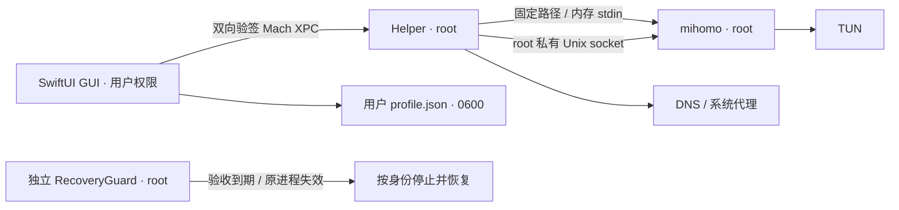

# ClairRoute

Apple Silicon 上的原生 macOS 代理客户端，最低 macOS 26，目标 macOS 27。Swift 6 + SwiftUI，内核固定为官方 mihomo v1.19.31。无遥测、广告、机场推荐或在线转换服务。

通过 Spotlight 搜索 ClairRoute 打开窗口，不显示 Dock 图标或菜单栏常驻图标。关闭窗口后应用继续在后台运行；从 Spotlight 再次打开可恢复窗口。在“高级与维护”点击“退出 ClairRoute”会先恢复网络再退出。

## 功能

- **增强模式与系统代理分别开关**：TUN 覆盖 TCP / UDP；系统代理设置 HTTP / HTTPS / SOCKS。出站可选规则、全局、直连。
- **节点和订阅**：SS AEAD / SS2022、VMess、VLESS Reality（含 `xtls-rprx-vision`），支持 TCP / WebSocket / gRPC 适用组合。手动表单、URI / Base64 列表、本地 YAML 导入、HTTPS YAML 订阅、刷新间隔、流量和到期时间、节点选择与延迟测试。
- **规则编辑**：正在运行的 App、选择 `.app`、bundle 可执行文件列表、进程名、DOMAIN / DOMAIN-SUFFIX / DOMAIN-KEYWORD / GEOSITE。拖拽或按钮排序，策略可选 PROXY、具体节点、DIRECT、REJECT；MATCH 兜底可选。
- **连接面板**：每 2 秒读取真实快照，显示进程、目标、命中规则、出站链和流量；选中或右键快捷添加规则。当前最多显示 200 条，无法识别进程时明确显示“未识别”。
- **高级 YAML**：语法高亮和安全白名单校验；可设置 DNS、IPv6、TUN stack / MTU 等。管理接口、权限、文件路径和命令不可覆盖。
- **恢复**：GUI watchdog、持久恢复记录、配置失败回滚、睡眠 / 网络变化处理，以及独立进程执行的 120 秒限时网络验收。
- **卸载**：应用内“完全卸载”先恢复网络并清除配置；若仍有旧版钥匙串条目，完成清理后再退出，并在终端请求管理员授权移除系统组件。

初次安装网络开关均关闭。默认规则为：

```yaml
rules:
  - 'PROCESS-PATH-REGEX,^/Applications/ChatGPT\.app/,PROXY'
  - 'MATCH,DIRECT'
```

它覆盖当前新版 ChatGPT bundle 内的辅助进程。其他 App、ChatGPT Classic 和无法归属到该路径的连接走 DIRECT。配置编辑后点击“应用配置”才改变运行会话；订阅自动刷新只更新本地资料库。默认规则下终端 curl 本应直连；验证全局接管时主动选“全局”。“直连”是出站模式，停止接管请关闭增强模式。

日常仅让 ChatGPT 走代理时，使用“增强模式开启、系统代理关闭、规则模式”。TUN 在网络层接管 TCP/UDP 后按规则分流；系统代理只对遵循 macOS HTTP/HTTPS/SOCKS 设置的应用生效，一般无需与 TUN 同时开启。

## 构建与本机安装

完整 Xcode 提供 Swift 编译器与 macOS SDK。无需额外 Swift 包，不需要付费开发者账号。

```bash
# 首次克隆后下载并校验固定版本内核。仅下载，不执行。
bash Scripts/fetch-core.sh

# 在项目目录执行。仅编译，不启动应用、内核或服务。
python3 Scripts/build-native.py
```

界面构建位于 `.build/Preview/Build/Products/Release/ClairRoute.app`。未配置受信任本机签名身份时，网络开关禁用。可查看和编辑界面；保存节点会写入当前用户的明文 `profile.json`。

推荐双击 `Scripts/Install ClairRoute.command`，或在终端执行下方命令。先退出 ClairRoute 预览；安装器复用或创建本机签名身份、构建后才请求管理员授权，最后验证两个空闲服务的真实 PID 与新鲜就绪记录。安装不会开启代理。

```bash
bash 'Scripts/Install ClairRoute.command'
```

需要分步操作时：

```bash
# 普通用户运行，不要 sudo。创建或复用 login Keychain 中的代码签名身份。
Scripts/create-local-identity.sh

# 填入上一步输出的40位SHA1。
IDENTITY='替换为证书SHA1'
Scripts/build-local.sh "$IDENTITY"

# 先退出所有 ClairRoute 窗口/进程。安装本身不启用代理。
sudo Scripts/install-local.sh "$IDENTITY"
open /Applications/ClairRoute.app
```

签名构建位于 `.build/Local/Build/Products/Release/ClairRoute.app`。安装脚本只使用该固定构建位置，先复制到 root 私有 staging，再验签、校验 SHA256，备份旧 App / 内核 / 数据 / 两个 daemon，完成事务替换。失败尝试回滚，恢复不完整则保留 `.maintenance` 和备份。已有未恢复记录时拒绝安装或卸载，不要删除记录绕过检查。

亦提供 `ClairRoute.xcodeproj` 与共享 scheme，包括 GUI、Helper、RecoveryGuard 三个 target。新增源文件后运行 `python3 Scripts/generate-project.py` 更新工程。Xcode 默认不签名；正式本机构建建议用上述脚本，确保三份签名与 sealed manifest 一致。

本机完整 `xcodebuild` 曾在加载 `IDESimulatorFoundation` 时因 `/Library/Developer/PrivateFrameworks/DVTDownloads.framework` 缺失符号而失败。`build-native.py` 直接调用已选 Xcode 的编译器并组装相同 bundle；没有修改系统 Xcode。SwiftUI 宏编译需要系统宏插件进程可运行。

## 签名方案

**没有付费账号：** 当前采用自签名代码签名证书、精确证书固定和需管理员授权的手动 LaunchDaemon。私钥留在 login Keychain，证书仅加入 codeSign 用途信任，不改变 TLS 信任。双方 XPC requirement 使用精确 bundle identifier + `certificate leaf` SHA1；二进制完整性另用 SHA256。此方式用于本机，不具备 Developer ID 公证与分发能力。

**有付费账号：** 可另做 Developer ID Application 签名、公证、staple 与 `SMAppService.daemon` 发布构建；双方 requirement 应使用 Apple anchor、固定 Team ID 和 identifier，适应证书续期。macOS 对后台 daemon 的注册 / 批准有签名和公证策略要求，不能将自签名或 ad-hoc 的 SMAppService 注册视为稳定发布方案。工程包含标准内嵌 daemon plist；当前实际可用的部署路径是手动本机安装。未使用 SMJobBless，也不关闭 SIP 或 Gatekeeper。

## 权限和秘密



- Helper 无 TCP 管理端口。mihomo controller 位于 root:wheel、0700 的 `run/`，不向 GUI 直接开放。固定 mihomo 的 Unix controller 不验证 HTTP secret 且自行设置 socket 权限，因此目录隔离和有限 XPC 是必要边界。
- XPC 仅接受有界类型：应用配置、停止 / 恢复、状态、心跳、固定连接快照、节点选择及固定目标测速。没有命令执行、任意路径、任意 YAML 或 HTTP 转发接口。检查当前 console UID、代码签名和会话所有权。
- 密码、服务器 UUID、订阅 URL、订阅原始数据、节点信息和规则统一保存到 `~/Library/Application Support/ClairRoute/profile.json`。这是用户明确选择的明文存储；文件权限为 `0600`，所属目录为 `0700`，有当前用户文件访问权限的程序仍可读取内容。不要把此文件加入源码、日志或公开附件。
- 当前文件格式为 v3：`nodes` / `subscriptions` 保存资料，`nodeSecrets` / `subscriptionSecrets` 保存凭据，内部引用用于关联记录。单文件上限为 32 MiB；导入、编辑、删除和订阅刷新都通过原子替换更新同一配置文件。失败时保留上一个完整版本，不会先覆盖一部分凭据再更新节点列表。日常启动、切换模式、读取节点和订阅刷新不访问钥匙串。
- 旧版钥匙串配置需在应用内明确执行一次迁移：先读取所有旧凭据，再原子保存 v3 明文文件，保存成功后才删除旧条目。读取阶段可能仍需要 macOS 授权；迁移失败时原资料保留。若旧条目删除失败，文件保留待清理引用，只在用户明确重试时访问钥匙串；日常使用不会自动重试。
- 本机代码签名私钥仍留在 login Keychain，用于构建和验签；它与订阅和节点凭据无关。重新安装仍需管理员授权，但不因正常读取新版配置而触发节点钥匙串提示。
- 配置在内存中从基础模板、用户规则、订阅规则生成。订阅由普通权限 GUI 以 ephemeral HTTPS 获取和本地解析，生成 inline proxy-providers；不让 root 内核读取订阅 URL 或创建含密码的 provider 缓存。
- mihomo `-t -f -` 经 stdin 校验，启动同样使用 stdin；热重载使用私有 socket 的 payload。上一版配置仅在内存保留，失败时回滚。没有写含密码的 config.yaml，没有把配置放进 argv 或日志。
- URI、YAML 和规则均按不可信输入处理。YAML 支持 JSON、普通缩进映射 / 序列、引号与 flow collection；不执行标签，不展开 anchor / alias，不合并任意外部 provider。超限、未知影响连接语义的字段或危险字段会明确拒绝，不在线转换。
- SS 插件仅允许内核支持的内置选项，不运行外部插件。SS2022 支持规范 Base64 单密钥，长度按 cipher 校验。

## 网络恢复与验收

默认 TUN 为 mixed、auto-route、auto-detect-interface、TCP / UDP 53 hijack、fake-ip，进程识别 strict。使用固定 `utun197`；已存在或检测到竞争 VPN / 默认隧道路由时拒绝启动。系统代理入口仅监听 `127.0.0.1:17890`，DNS 在 TUN 开启时监听 loopback 53，没有 LAN 管理接口。

Helper 串行管理配置应用，先预检，再等内核状态健康，再修改系统设置。关闭监听前恢复指向它的 DNS / 代理。按 network service UUID 记录原值，恢复时只撤销仍由本应用拥有的值，不盲目覆盖另一 VPN 或用户后来修改的设置。

生产内核以 suspended 状态创建，先持久记录固定路径、PID、出生时间和接口身份，再恢复执行。Helper 重启按身份回收旧内核并恢复网络。GUI 退出等待恢复；进程退出 / XPC 断开 / 心跳租约过期触发恢复。休眠暂停 GUI 租约判断，唤醒有宽限；网络事件合并后重新检测和应用，失败保守关闭。

**首次联网验收使用“开始 120 秒 TUN 验收”：**

如果当前连接依赖其他客户端的 TUN，可先选择“开始 120 秒系统代理验收”：保持现有客户端运行，只把系统代理临时指向 ClairRoute；不创建新 TUN、不修改 DNS，到期恢复原代理。这只验证内核与系统代理恢复，不代表独立 TUN 分流已验证。任何新代理都可能暂时影响遵循系统代理的连接；限时回滚仍然启用。不要直接关闭维持当前会话的其他 TUN。

1. 先完成离线测试、安装及恢复服务状态检查，保留现有其他代理客户端的安装和配置。
2. 一次只改变一个接管方式。不要同时开启其他客户端的增强模式。
3. Helper 必须看到独立 RecoveryGuard 的真实 root 进程与新鲜心跳，才允许限时会话开始。
4. Guard 用连续时钟计算固定 120 秒期限，睡眠时间也计入；重配不能延长期限或偷偷转成普通会话。
5. 到期先写持久恢复标记阻止新会话，按固定路径、root UID、PID 和出生时间确认 Helper，再终止它并取得跨进程锁，恢复内核 / DNS / 系统代理。与 Helper 不并发写恢复状态，PID 复用不会导致误杀。
6. 回滚不需要 GUI、网络或远程助手在线；恢复未成功会保留记录并继续阻止启动。物理网络故障或系统网络 API 失效仍可能需要本机处理，不能承诺任何故障下绝不离线。

**本机恢复入口：** 应用“恢复网络并关闭代理”；GUI 失效时由 Helper watchdog 处理；限时验收中由独立 Guard 到期恢复。不要使用全局 route flush、删除 utun 或删除恢复 journal 代替恢复。需要手动重启守护进程时，固定命令如下（会停止 ClairRoute 当前会话）：

```bash
sudo launchctl kickstart -k system/local.nano.ClairRoute.RecoveryGuard
sudo launchctl kickstart -k system/local.nano.ClairRoute.Helper
```

普通会话不会因 Guard 空闲心跳而改动网络；“直连”模式也不等于关闭 TUN。

## 离线测试与实际验收

`Tests/` 的解析、golden 配置、排序、资料事务、响应头和恢复判定测试使用虚构凭据、临时目录及模拟旧版 vault，不访问真实 Keychain、订阅网络或系统网络设置。测试命令见 `Tests/README.md`，验收记录见 `Docs/Verification.md`。

实际验收必须分别记录：computer use 界面操作、签名与安装、TUN / 系统代理、真实节点连接与延迟、进程规则命中、LAN 端口检查、GUI 强杀、唤醒与切网。编译成功或纯函数测试通过不能替代这些验收；合盖 30 分钟和真实热点切换需要单独观察。

## 完全卸载

在“高级与维护”点击“完全卸载 ClairRoute”，确认后程序恢复网络、清除明文节点 / 订阅配置并退出，终端请求管理员授权移除组件。若仍有旧版钥匙串数据，先完成清理；失败时保留待清理引用，不跳过失败直接删除记录。

也可先手动恢复、删除本应用全部节点和订阅、退出，再执行：

```bash
sudo Scripts/uninstall-local.sh
```

移除范围：`/Applications/ClairRoute.app`、两个 `local.nano.ClairRoute.*` LaunchDaemon、`/Library/Application Support/ClairRoute`、当前用户 `~/Library/Application Support/ClairRoute`。检测到节点、订阅、任何非空凭据字典、待删除旧版 Keychain 引用或恢复记录时拒绝删除，格式未知或损坏的配置也会保留。签名证书 / 私钥和项目源码保留；不再使用时在钥匙串访问中删除 `ClairRoute Local Development`，并自行删除项目目录。

## 固定资源与许可

内核来自 [MetaCubeX/mihomo 官方 v1.19.31](https://github.com/MetaCubeX/mihomo/releases/tag/v1.19.31)。原始压缩包、原始二进制和本机重签二进制的 SHA256 分开记录；Helper 信任签名 App 封装的 manifest。内核更新仅通过修改固定官方版本与摘要、重新下载 / 编译 / 签名进行，不自动更新。

GEOSITE 来自 [MetaCubeX/meta-rules-dat](https://github.com/MetaCubeX/meta-rules-dat) 的 2026-09-30 数据快照，SHA256 固定在 GeoManifest.json，随 App 打包；安装及 Helper 均校验，root 不自动下载规则库。

上游 GPL-3.0 原文见 `Resources/mihomo-LICENSE`，来源和快照见 `THIRD-PARTY-NOTICES.txt`。上游另有衍生软件名称不含 Mihomo 的使用声明，故本客户端命名 ClairRoute。当前为用户本机开发；公开分发前应落实对应源码、构建资料、许可和公证义务。GUI 发布许可证尚未单独选定。
