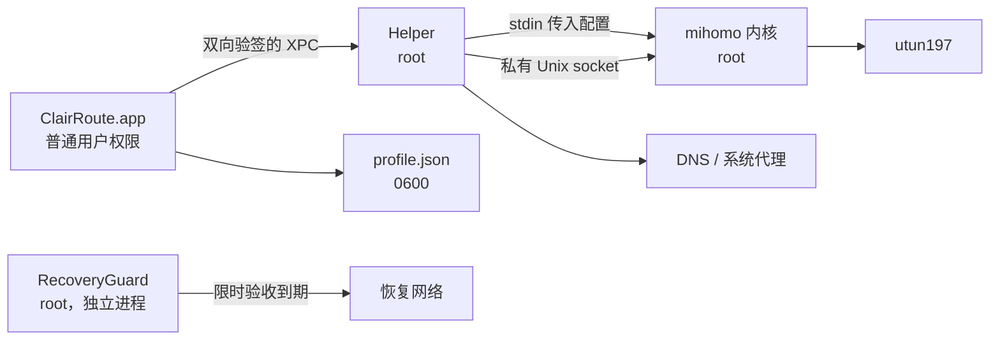

# ClairRoute

一个原生的 macOS 代理客户端，内核使用官方 [mihomo](https://github.com/MetaCubeX/mihomo)。

ClairRoute 用 Swift 6 和 SwiftUI 编写，界面简洁，默认只让你指定的 App 走代理，其余流量保持直连。它把“出问题时能把网络恢复原样”当作第一优先级：不管是界面被强制退出、电脑睡眠唤醒，还是切换 Wi-Fi，后台服务都会把它改过的 DNS 和代理设置还原回去。

没有遥测，没有广告，不推荐机场，也不调用任何在线订阅转换服务。

> [!NOTE]
> 目前只支持 **Apple Silicon + macOS 26 或更新版本**，需要在本机用 Xcode 构建安装，暂不提供可直接下载的安装包。

## 功能一览

- **两种接管方式，分别开关**：增强模式（TUN）在网络层接管所有 TCP / UDP；系统代理只影响遵循 macOS 代理设置的应用。
- **三种出站模式**：规则、全局、直连。
- **节点与订阅**：支持 Shadowsocks（含 SS2022）、VMess、VLESS（含 Reality 和 `xtls-rprx-vision`），传输支持 TCP / WebSocket / gRPC。可以手动填写、粘贴分享链接、导入 Clash / mihomo YAML，或者添加 HTTPS 订阅并定时刷新，还能看到流量用量和到期时间。
- **按 App 分流**：直接从正在运行的 App 里选，或选择一个 `.app`，也支持进程名、域名、域名后缀、关键词和 GEOSITE 分类。规则可拖动排序。
- **连接面板**：实时查看每条连接来自哪个进程、访问了哪里、命中了哪条规则、走了哪个节点，右键就能为它加规则。
- **安全的高级设置**：可以改 DNS、IPv6、TUN 协议栈和 MTU 等，但无法改动监听端口、控制接口或文件路径。
- **自动恢复网络**：界面退出或崩溃、心跳超时、睡眠唤醒、网络切换时都会检查并在必要时恢复原有设置。首次使用还可以做 120 秒限时验收，到期自动回滚。

## 安装

你需要：

- 一台 Apple Silicon Mac，系统为 macOS 26 或更新版本
- 完整安装的 Xcode（不是只有命令行工具），并在 Xcode 设置 › Locations 里选中它
- 管理员密码（安装后台服务时需要）

不需要付费的 Apple 开发者账号。

```bash
git clone https://github.com/yufei-zhou/ClairRoute.git
cd ClairRoute
bash 'Scripts/Install ClairRoute.command'
```

也可以在 Finder 里双击 `Scripts/Install ClairRoute.command`。安装器会依次：

1. 下载固定版本的官方 mihomo 内核并校验 SHA256（只下载，不执行）；
2. 在你的登录钥匙串里创建（或复用）一个仅用于本机代码签名的证书；
3. 编译并签名 App、Helper 和 RecoveryGuard；
4. 在终端里请求管理员密码，把 App 装到 `/Applications`，并注册两个空闲的后台服务。

安装完成后网络开关都是关着的，不会自动开始代理。如果想分步执行或了解每一步做了什么，见 [从源码构建](#从源码构建)。

## 快速上手

1. **打开 App**：用 Spotlight 搜索 “ClairRoute”。它不在 Dock 和菜单栏显示图标；关闭窗口后仍在后台运行，再从 Spotlight 打开即可回到窗口。
2. **添加节点**：在“节点与订阅”里手动添加、导入分享链接或 YAML，或者添加订阅后点“刷新”。
3. **选择节点**：在节点列表里点“使用”。
4. **先做一次限时验收（推荐）**：在“概览”点“开始 120 秒 TUN 验收”，确认网络正常；120 秒后会自动还原。
5. **正式开启**：在“概览”打开“增强模式（TUN）”，出站模式选“规则”。

### 默认只有 ChatGPT 走代理

全新安装时只有一条规则：

```yaml
rules:
  - 'PROCESS-PATH-REGEX,^/Applications/ChatGPT\.app/,PROXY'
  - 'MATCH,DIRECT'
```

也就是说，只有 `/Applications/ChatGPT.app` 里的进程走代理，其他所有流量都直连。想让更多 App 或网站走代理，到“规则”页添加，或者把“其余流量”改成 `PROXY`。

修改节点、规则或高级设置后，点右上角的“应用配置”才会作用到正在运行的会话；订阅自动刷新只会更新节点列表，不会悄悄改变正在运行的代理。

## 常见问题

**增强模式和系统代理要一起开吗？**
一般不用。日常推荐“增强模式开、系统代理关、规则模式”。增强模式已经在网络层接管了所有流量；系统代理只对浏览器等遵循系统代理设置的应用生效，适合不想创建 TUN 的场景。

**“直连”模式和关闭开关有什么区别？**
“直连”只是把出站策略设为全部直连，接管仍在进行。想彻底停止，请关闭两个开关，或点“恢复网络并关闭代理”。

**能和 ClashX、Surge 等其他代理客户端同时用吗？**
不要同时开启两个客户端的增强模式。ClairRoute 检测到其他 VPN 或隧道占用默认路由时会拒绝启动 TUN。可以先用“120 秒系统代理验收”在不关闭其他客户端的情况下试用。

**网络出问题了怎么办？**
先在 App 里点“恢复网络并关闭代理”。如果界面打不开，后台的 Helper 会在心跳超时后自动恢复。仍不行时可以重启两个后台服务（会结束当前代理会话）：

```bash
sudo launchctl kickstart -k system/local.nano.ClairRoute.RecoveryGuard
sudo launchctl kickstart -k system/local.nano.ClairRoute.Helper
```

请不要手动删除恢复记录、删除 utun 网卡或清空路由表，这些操作会让 ClairRoute 无法正确还原你的原始设置。

**我的密码和订阅地址存在哪里？**
存放在 `~/Library/Application Support/ClairRoute/profile.json`，是**明文**，文件权限 `0600`（只有你的账户能读）。能以你的身份运行的程序仍然可以读到它，所以不要把这个文件提交到代码仓库、贴到日志或发给别人。订阅由界面进程直接下载并在本机解析，root 权限的内核看不到订阅地址。

**为什么不放在钥匙串里？**
早期版本把凭据放在钥匙串里，现在改为上面的本机配置文件，日常启动、切换模式和刷新订阅都不再访问钥匙串。如果你的配置来自旧版本，App 会提示你点一次“迁移旧配置”；迁移失败时原数据保持不变。

## 卸载

在“高级与维护”页点“完全卸载…”。App 会先恢复网络、删除本应用保存的节点和订阅，然后打开终端请求管理员密码移除系统组件。

也可以手动执行：先在 App 里恢复网络、删除所有节点和订阅并退出，然后运行

```bash
sudo Scripts/uninstall-local.sh
```

会被移除的内容：`/Applications/ClairRoute.app`、两个 `local.nano.ClairRoute.*` 后台服务、`/Library/Application Support/ClairRoute` 和 `~/Library/Application Support/ClairRoute`。如果检测到还有节点、订阅或未完成的恢复记录，卸载会拒绝执行，以免误删数据。本机签名证书不会被删除，不再需要时可以在“钥匙串访问”里删除 `ClairRoute Local Development`。

## 工作原理



- 界面以普通用户身份运行，只能通过一组固定、有长度上限的 XPC 请求和 root 权限的 Helper 通信；双方都校验对方的代码签名。没有执行命令、任意路径、任意 YAML 或 HTTP 转发之类的接口。
- 配置只在内存中生成，经 stdin 交给内核，不会写出含密码的配置文件，也不会出现在命令行参数或日志里。
- 内核的控制接口是 root 私有目录下的 Unix socket，没有 TCP 管理端口；代理入口只监听 `127.0.0.1:17890`，不对局域网开放。
- Helper 按网络服务记录被修改前的 DNS 和代理设置，恢复时只撤销仍由自己设置的值，不会覆盖你或其他软件后来做的修改。
- 订阅、分享链接和 YAML 一律视为不可信输入：解析器有严格的大小和深度限制，拒绝外部脚本、外部 provider 和会改变节点行为的未知字段。订阅里 ClairRoute 不支持的规则类型（如 GEOIP、IP-CIDR）和链接列表中的其他协议会被跳过，并在界面上提示。

更详细的设计说明见 [Docs/Architecture.md](Docs/Architecture.md)。

## 从源码构建

只编译、不安装（得到一个不能开启代理的界面预览版本）：

```bash
bash Scripts/fetch-core.sh        # 下载并校验固定版本内核，不执行
python3 Scripts/build-native.py   # 输出到 .build/Preview/Build/Products/Release/ClairRoute.app
```

分步完成签名构建和安装：

```bash
Scripts/create-local-identity.sh                 # 普通用户运行，输出证书的 40 位 SHA1
IDENTITY='上一步输出的 SHA1'
Scripts/build-local.sh "$IDENTITY"               # 输出到 .build/Local/Build/Products/Release/ClairRoute.app
sudo Scripts/install-local.sh "$IDENTITY"        # 先退出所有 ClairRoute 窗口
```

安装脚本会先把构建产物复制到 root 私有的临时目录，校验签名和 SHA256，备份旧版本后再整体替换；失败时自动回滚。

仓库也包含 `ClairRoute.xcodeproj`（GUI、Helper、RecoveryGuard 三个 target），方便在 Xcode 里浏览和调试。新增源文件后运行 `python3 Scripts/generate-project.py` 更新工程。Xcode 工程默认不签名，正式本机构建请用上面的脚本。

### 测试

```bash
zsh Tests/run.sh             # 解析器、配置生成、资料库事务等离线测试，不访问网络和钥匙串
zsh Tests/core-preflight.sh  # 可选：用固定内核的 -t 模式校验生成的配置
```

离线测试通过只说明代码逻辑正确，不代表真实联网可用。真实环境的验收记录见 [Docs/Verification.md](Docs/Verification.md)。

### 目录结构

| 目录 | 内容 |
| --- | --- |
| `App/` | SwiftUI 界面、资料库、订阅下载 |
| `Helper/` | root Helper 与 RecoveryGuard |
| `Shared/` | 共用模型、YAML / 订阅解析器、配置生成器 |
| `Scripts/` | 下载内核、构建、签名、安装、卸载 |
| `Tests/` | 离线测试与签名预检 |
| `Resources/` | Info.plist、LaunchDaemon 定义、GEOSITE 数据、第三方许可 |
| `Docs/` | 架构、组件契约、验收记录 |

## 签名与发布状态

当前使用本机自签名证书加精确证书指纹固定，适合在自己的电脑上使用，但不具备 Developer ID 签名和公证，不能直接分发给别人安装。要做公开发布，还需要 Developer ID 签名、公证、`SMAppService` 注册，以及把 XPC 校验改为 Apple 根证书加 Team ID。详见 [Docs/Architecture.md](Docs/Architecture.md#签名方案)。

## 许可与致谢

- 内核：[MetaCubeX/mihomo](https://github.com/MetaCubeX/mihomo) v1.19.31，GPL-3.0，原文见 `Resources/mihomo-LICENSE`。内核未做修改，只做了本机代码签名；更新内核只能通过修改固定版本号和摘要后重新构建。
- 域名分类数据：[MetaCubeX/meta-rules-dat](https://github.com/MetaCubeX/meta-rules-dat) 的 `geosite.dat`（2026-09-30 快照，SHA256 固定在 `Resources/GeoManifest.json`）。
- 来源和快照信息见 `Resources/THIRD-PARTY-NOTICES.txt`。mihomo 上游请求衍生软件不要在名称中使用 “mihomo”，因此本项目命名为 ClairRoute，与 MetaCubeX 无关联。

ClairRoute 本身的源码许可证尚未确定。
